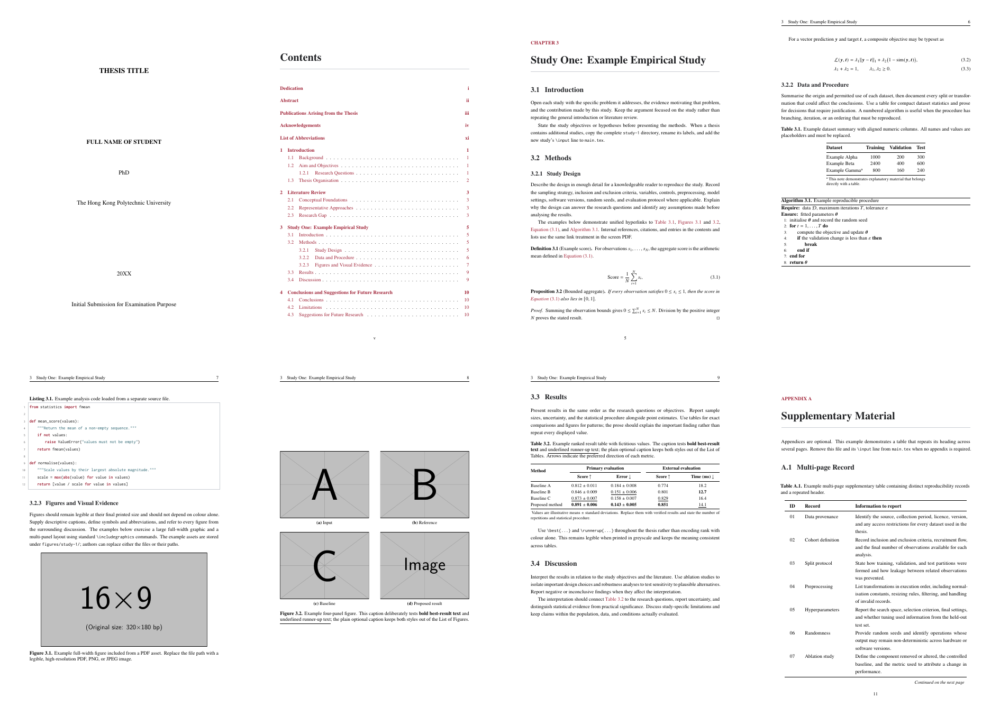

# PolyU Thesis LaTeX

An unofficial, anonymous-ready thesis template based on the PolyU [Research Postgraduate Student Handbook](https://www.polyu.edu.hk/gs/rpghandbook/ref-regulations-format-thesis/). It includes the required front matter and examples of common academic content. This community project is not affiliated with or endorsed by The Hong Kong Polytechnic University; authors remain responsible for checking the current submission requirements.

## Preview

[](assets/thesis-showcase-new.png)

For the complete set of styles and full-resolution examples, [download the compiled PDF](thesis.pdf).

## Quick start

### AI-assisted setup

For the easiest first-time setup, give [SETUP.md](SETUP.md) to an AI coding agent with terminal access. The agent will detect the operating system, guide or perform a compact English-only TeX Live installation, clone this project, collect the required thesis metadata, compile the document, and open `thesis.pdf` with the system default application. It will request confirmation before installing software or using administrator privileges.

If the agent is already running inside this project, it will use the current copy. Otherwise, it will clone [github.com/jinggqu/PolyU-Thesis-LaTeX](https://github.com/jinggqu/PolyU-Thesis-LaTeX) after confirming the destination directory.

### Build in VS Code

After setup, open the project in [Visual Studio Code](https://code.visualstudio.com/) with the [LaTeX Workshop](https://marketplace.visualstudio.com/items?itemName=James-Yu.latex-workshop) extension. Press `Cmd+Option+B` on macOS or `Ctrl+Alt+B` on Windows/Linux. The resulting file is `thesis.pdf` in the project root.

### Terminal alternative

```text
latexmk main.tex       Build or update the thesis
latexmk -pvc main.tex  Rebuild automatically after changes
latexmk -c main.tex    Remove intermediate files but keep the PDF
latexmk -C main.tex    Remove intermediate files and the PDF
```

These commands are the same on Windows, macOS, and Linux.

## Main files and directories

```text
.vscode/settings.json     Default LaTeX Workshop build recipe
.latexmkrc                Cross-platform latexmk configuration
SETUP.md                  Copyable prompt for AI-assisted setup
LICENSE                   MIT license
main.tex                  Document order
metadata.tex              Thesis data and optional-component switches
preamble.tex              Packages, bibliography, and PDF setup
polyu-thesis.cls          Thesis layout and styles
references.bib            Bibliography database
assets/                   README preview images
frontmatter/              Declaration, abstract, publications, acknowledgements
chapters/                 General chapters and study directories
  study-1/
    main.tex              Study title and section order
    01-introduction.tex
    02-methods.tex
    03-results.tex
    04-discussion.tex
tables/study-1/           Study-specific tables
figures/study-1/          Study-specific figures
code/study-1/             Study-specific source listings
appendices/               Appendices
```

Shared assets may remain at the root of `tables/`, `figures/`, or `code/`. To add another study, copy the matching `study-1` directories, update labels and paths, and add `\input{chapters/study-N/main}` to `main.tex`.

## Common settings

- Change `onehalf` to `double` at the top of `main.tex` for double spacing.
- Change an optional switch from `true` to `false` in `metadata.tex` to omit it.
- Use `\Cref{...}` for automatic Equation, Figure, Table, and Algorithm names.
- Use `\best{...}` and `\runnerup{...}` for ranked table results.
- Use a plain optional caption when the full caption contains formatting:

```latex
\caption[Plain list entry.]{Detailed caption with \best{best} and \runnerup{runner-up}.}
```

## Crop PDF figures

The optional script crops the newest PDF under `figures/`, or the newest requested number of PDFs. It requires Bash and `pdfcrop`; use Git Bash or WSL on Windows.

```text
bash pdfcrop.sh
bash pdfcrop.sh 3
```

An invalid or omitted count defaults to one.

## License

Released under the [MIT License](LICENSE).
